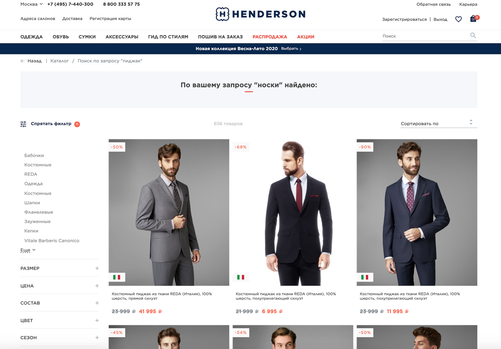

# HQP-3 — La cabecera muestra simultáneamente las opciones de registro y cierre de sesión

**Tipo:** Bug / Error  
**Estado registrado en Jira:** Por hacer  
**Prioridad propuesta:** Medium

Referencia: BR-03

## Entorno
Captura de pantalla de HENDERSON proporcionada en un ejercicio académico de Netology. Sistema operativo y navegador desconocidos.

## Contexto
La captura muestra las opciones de acceso en la parte superior derecha. No es posible confirmar el estado de autenticación del usuario únicamente con la imagen.

## Pasos de revisión

1. Abrir la captura de pantalla proporcionada.
2. Localizar las opciones de acceso en la parte superior derecha.
3. Comprobar qué opciones aparecen simultáneamente.

## Resultado actual
La cabecera muestra simultáneamente «Зарегистрироваться» (Registrarse) y «Выход» (Cerrar sesión).

## Resultado esperado
Las opciones de acceso corresponden al estado de autenticación. Para una sesión iniciada, se muestra «Выход» y se oculta «Зарегистрироваться», siempre que así lo establezcan los requisitos.

## Severidad
Menor (Minor).

## Evidencia

## Alcance de la revisión

Hallazgo documentado a partir de una imagen estática. La severidad y la prioridad son estimaciones del ejercicio. No se verificó la reproducibilidad en el sitio actual ni una corrección del producto.
