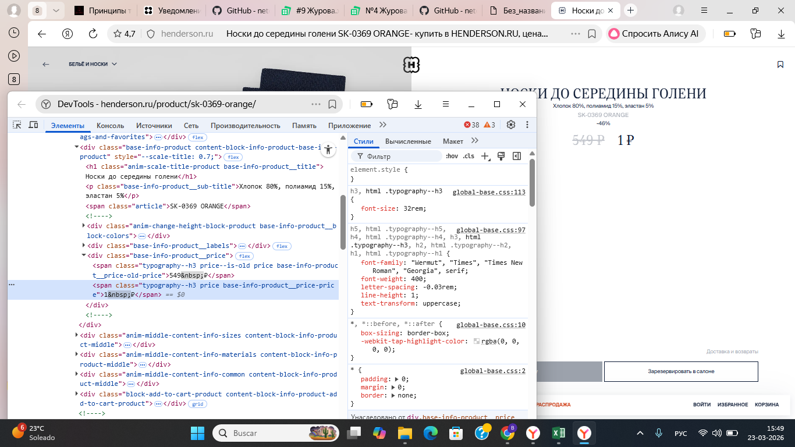
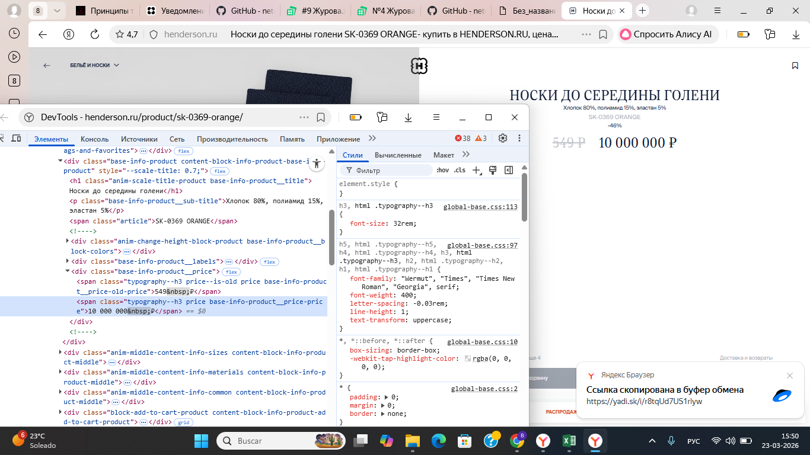

# Modificación del precio mediante DevTools en HENDERSON

## Objetivo

Practicar la edición del contenido HTML mediante la pestaña Elements de las herramientas de desarrollo del navegador.

## Página utilizada

https://henderson.ru/product/sk-0369-orange/

Producto: calcetines, referencia SK-0369 ORANGE.

## Herramientas

Yandex Browser y DevTools, pestaña Elements.

## Acciones realizadas

1. Abrir la página del producto.

2. Abrir DevTools y seleccionar la pestaña Elements.

3. Localizar el elemento HTML que contiene el precio actual.

4. Cambiar su contenido a 1 ₽ y observar el resultado en la página.

5. Cambiar el mismo contenido a 10 000 000 ₽ y observar el resultado.

## Resultado observado

La página mostró los valores introducidos: primero 1 ₽ y después 10 000 000 ₽.

## Alcance

Los cambios se realizaron localmente en el navegador. Este ejercicio no demuestra una modificación del precio en el servidor ni del importe de compra.

## Evidencias

Figura 1. Precio modificado localmente a 1 ₽.

Figura 2. Precio modificado localmente a 10 000 000 ₽.

