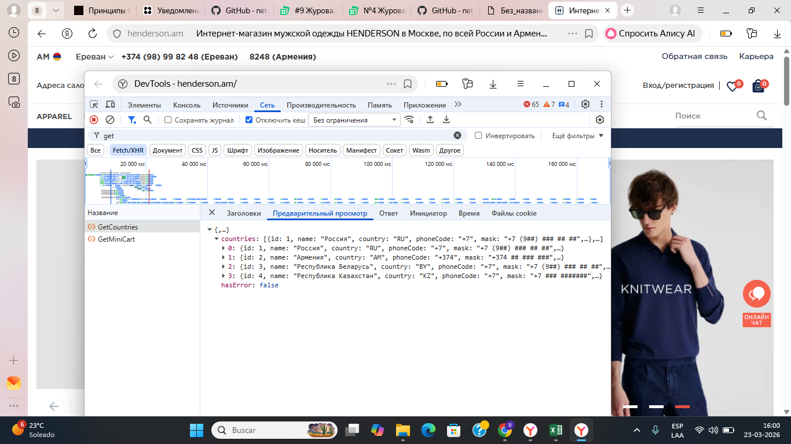

# Inspección de una solicitud de red en HENDERSON

## Objetivo

Localizar una solicitud y consultar su respuesta en DevTools.

## Entorno y acciones

Sitio: https://henderson.am/. Navegador: Yandex Browser.

1. Abrir el sitio y DevTools.
2. Seleccionar Network.
3. Localizar GetCountries.
4. Consultar la respuesta en Preview.

## Resultado observado

La respuesta contiene una lista de países con los campos `id`, `name`, `country`, `phoneCode` y `mask`, y el campo `hasError` con valor `false`.

## Alcance

Ejercicio de consulta de una solicitud y su respuesta. No se modificaron datos ni se verificó su exactitud frente a requisitos. No constituye una prueba completa de API.

## Evidencia

