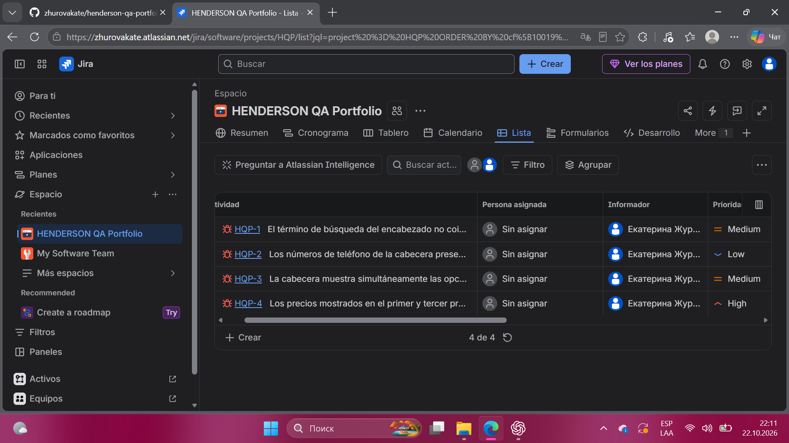

# HENDERSON — Portafolio QA Manual Junior

Proyecto académico realizado durante mi formación en Netology. Reúne la documentación de cuatro hallazgos identificados en una captura de pantalla y registrados posteriormente en Jira.

Mi objetivo es demostrar cómo documento observaciones de interfaz, comparo resultados actuales y esperados, y organizo reportes con evidencias y prioridades propuestas.

## Alcance

Los cuatro reportes proceden de una captura proporcionada en el ejercicio. No representan defectos confirmados en la versión actual del sitio. La imagen no permite identificar el navegador, el sistema operativo ni el estado de autenticación del usuario.

El proyecto es independiente y no representa una colaboración profesional con HENDERSON.

## Reportes

| ID en Jira | Título | Prioridad propuesta |
| --- | --- | --- |
| [HQP-1](bug-reports/HQP-1.md) | El término de búsqueda del encabezado no coincide con el de la ruta de navegación | Medium |
| [HQP-2](bug-reports/HQP-2.md) | Los números de teléfono de la cabecera presentan formatos diferentes | Low |
| [HQP-3](bug-reports/HQP-3.md) | La cabecera muestra simultáneamente las opciones de registro y cierre de sesión | Medium |
| [HQP-4](bug-reports/HQP-4.md) | Los precios mostrados en el primer y tercer producto no corresponden a los descuentos anunciados | High |

Los identificadores originales BR-01 a BR-04 se conservan dentro de los reportes. Los textos se basan en la exportación de Jira; los cambios de formato facilitan su lectura en GitHub.

El reporte HQP-2 requiere aclarar los requisitos de diseño: una diferencia en el formato de los teléfonos no confirma por sí sola un defecto. El resultado esperado de HQP-3 también depende de los requisitos de acceso.

## Práctica con Jira

- Creación de un espacio con tablero Kanban.
- Registro de cuatro elementos de tipo Bug / Error.
- Documentación de contexto, pasos de revisión y resultados actuales y esperados.
- Asignación de prioridades y de la etiqueta `portfolio`.
- Incorporación de la captura como archivo adjunto.
- Consulta de los reportes en el tablero y en la lista, y exportación a CSV.

Los reportes permanecen en el estado «Por hacer». No se documentó una corrección ni una prueba de regresión.

### Vista de los reportes en Jira

## Evidencia y criterios

La [captura original](evidence/search-results.png) se comparte entre los cuatro reportes. Los textos del interfaz se conservan en ruso para poder contrastarlos con la imagen; las explicaciones están en español.

La severidad describe el impacto estimado. La prioridad indica el orden sugerido de atención dentro de este ejercicio. No son decisiones de un equipo de producto.

En HQP-4, los cálculos esperados suponen que la etiqueta de descuento se aplica al precio anterior mostrado. El redondeo depende de las reglas del sitio. No se comprobó el importe en el carrito ni en el pago.

## Otros trabajos del proyecto

| Trabajo | Contenido y alcance |
| --- | --- |
| [Lista de verificación](checklists/area-personal.md) | 13 comprobaciones propuestas, organizadas por módulo a partir de la exploración del área personal. No incluye resultados de ejecución. |
| [Recuperación de contraseña](documents/recuperacion-contrasena.md) | Escenario por teléfono realizado en la práctica; rama por email documentada hasta el envío del correo. Incluye preguntas pendientes de verificación. |
| [Edición de HTML](devtools/edicion-html.md) | Cambio local del precio a 1 ₽ y 10 000 000 ₽ mediante Elements. No modifica el precio en el servidor. |
| [Consulta de una solicitud](devtools/network.md) | Inspección de GetCountries y de su respuesta en henderson.am mediante Network y Preview. |

## Archivos originales

- [Checklist en Excel](documents/Checklist_Henderson_ES.xlsx).
- [Reportes en Excel](documents/Bug_Reports_Henderson_ES.xlsx).
- [Escenario en Word](documents/Recuperacion_Contrasena_Henderson_ES.docx).
- [Ejercicio de HTML en Word](documents/DevTools_Henderson_ES.docx).

Los documentos originales se conservan sin modificaciones. Las versiones Markdown facilitan la lectura en GitHub. En la versión Markdown del checklist se normalizó la escritura de «Alta» y se repitió el módulo en cada fila para facilitar su lectura.

## Herramientas utilizadas

Jira, hojas de cálculo, Word, Yandex Browser y DevTools. Markdown para presentar la documentación en GitHub.
